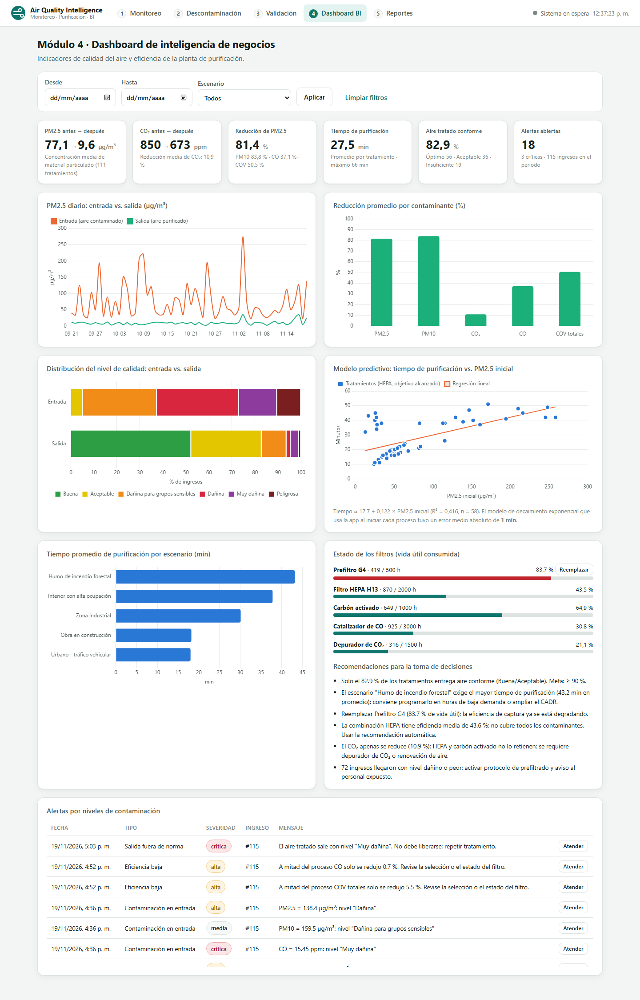
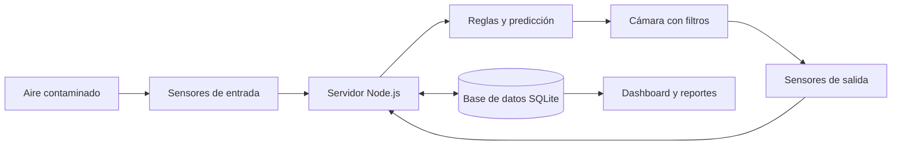

# Taller 6 - Purificación de Aire (Air Quality Intelligence)

Este es mi proyecto para el taller 6 de Inteligencia de Negocios. La idea era responder una pregunta: ¿cómo hacer una aplicación que detecte cuándo entra aire contaminado, mire qué trae, lo purifique y después compruebe si de verdad quedó limpio?

Lo que hice fue simular una cámara de purificación de 60 m³. El aire entra, unos sensores (simulados) miden qué tan contaminado viene, el sistema escoge qué filtros usar, lo limpia durante un tiempo y al final lo vuelve a medir. Todo queda guardado en una base de datos y con eso armé un dashboard para analizar los resultados.

- **Video:** https://youtu.be/svWP9xG1EHo
- **Informe:** [Informe técnico en PDF](docs/Informe_Tecnico_Air_Quality_Intelligence.pdf)



## Cómo correrlo

Solo se necesita tener Node.js instalado (versión 22.13 o más nueva). No hay que instalar paquetes.

```bash
git clone https://github.com/jfte278/TALLER-6---Purificaci-n-de-Aire.git
cd TALLER-6---Purificaci-n-de-Aire
npm start
```

Después se abre http://localhost:3000 en el navegador. La primera vez se demora un par de segundos más porque crea la base de datos y le carga dos meses de datos de ejemplo, para que el dashboard no salga vacío.

Otros comandos que dejé:

- `npm run seed` vuelve a crear la base de datos desde cero.
- `npm run analisis` saca las estadísticas de antes y después y las guarda en `docs/analisis_resultados.md`.
- `npm test` corre unas pruebas para revisar que los cálculos estén bien.
- `python analisis/analisis_calidad_aire.py` hace un análisis parecido en Python y exporta los datos a CSV.

## Lo que tiene la aplicación

**1. Monitoreo.** Uno escoge de dónde viene el aire (tráfico, zona industrial, humo de incendio, un salón lleno de gente o una obra) y le da a *Detectar ingreso de aire*. Se guardan la fecha y la hora, y se mide PM2.5, PM10, CO₂, CO y COV. Cada valor sale con un color según qué tan grave es. Para eso usé como referencia el índice de calidad del aire de Colombia (Resolución 2254 de 2017). Si algo está muy alto salen alertas, y el sistema dice qué filtros conviene usar y cuánto se va a demorar.

**2. Descontaminación.** Aquí se escogen los filtros, se pone el tiempo y se activa la purificación. Se ve cómo baja cada contaminante minuto a minuto y cada lectura queda guardada. Si se quita un filtro que hace falta, la aplicación avisa.

**3. Validación.** Cuando termina, se mide el aire otra vez y se compara con cómo llegó: cuánto bajó cada contaminante y si el resultado fue óptimo, aceptable o insuficiente.

**4. Dashboard.** Tiene 6 indicadores: PM2.5 antes y después, CO₂ en ppm, porcentaje de reducción, tiempo promedio, porcentaje de aire que sale bien y alertas abiertas. También tiene 5 gráficos, el estado de los filtros, las alertas y unas recomendaciones que se generan solas. Se puede filtrar por fechas y por tipo de aire.

**5. Reportes.** Un resumen para quien toma decisiones, con opción de descargarlo en CSV o imprimirlo en PDF.

## Algo que aprendí con los filtros

No hay un filtro que sirva para todo. El HEPA atrapa casi todas las partículas, pero los gases le pasan de largo. El carbón activado sirve para los COV, pero casi no hace nada con el CO ni con el CO₂. Para el CO toca usar un catalizador, y para el CO₂ un depurador especial o renovar el aire. Por eso la aplicación no usa siempre los mismos filtros, sino que los escoge según lo que detectan los sensores. En los datos se nota: cuando se usó solo HEPA, la eficiencia promedio bajó a menos del 45 %.

## La parte "inteligente"

La guía pedía una regla de alertas o un modelo predictivo, y yo hice las dos cosas.

- **Alertas:** saltan cuando el aire llega muy contaminado, cuando a mitad del proceso un contaminante no ha bajado ni el 40 %, cuando el aire sale todavía malo y cuando un filtro ya pasó el 80 % de su vida útil.
- **Predicción del tiempo:** la concentración en la cámara baja de forma exponencial, `C(t) = C∞ + (C₀ − C∞)·e^(−k·t)`, y *k* depende de los filtros que se estén usando. Despejando el tiempo se sabe cuántos minutos va a tardar. En las pruebas se equivocó más o menos 1 minuto. También hice una regresión lineal entre el PM2.5 inicial y el tiempo, que se ve en el dashboard.

## Con qué está hecho

- **Interfaz:** HTML, CSS y JavaScript, con Chart.js para los gráficos.
- **Servidor:** Node.js, sin librerías externas.
- **Base de datos:** SQLite. Escogí SQLite y no MySQL porque así cualquiera lo puede correr sin montar un servidor de base de datos. Igual dejé el script para PostgreSQL en `db/schema_postgresql.sql`, por si se quiere pasar allá.
- **Análisis:** Node.js y un script en Python.



## Dónde está cada cosa

```
server.js        servidor y rutas de la API
src/             la lógica: contaminantes, filtros, simulación, alertas y cálculos del dashboard
db/              estructura de la base de datos (SQLite y PostgreSQL)
public/          la página web
scripts/         datos de ejemplo, análisis, pruebas y generación del informe
analisis/        script en Python
docs/            informe, análisis de resultados, guion del video y capturas
```

## Sobre los datos

Los datos son simulados porque no tenía sensores reales. Aun así no son números al azar: salen del modelo de la cámara, con la capacidad y la eficiencia de cada filtro, e incluso con el desgaste de los filtros con el uso. Si más adelante se quisieran usar sensores de verdad (por ejemplo un PMS5003 para partículas, un SCD30 para CO₂ y un MQ-7 para CO con un ESP32), podrían enviar los datos a la misma API.

---

José Fernando Téllez · 2026
