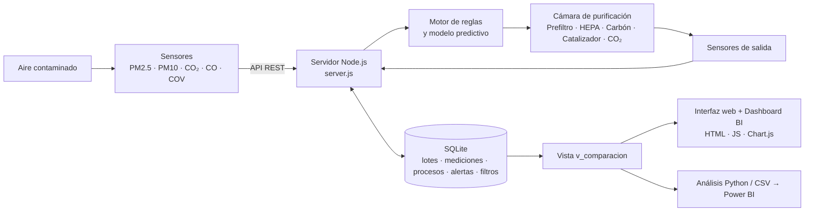

# Air Quality Intelligence

Sistema inteligente para el **monitoreo, descontaminación y purificación del aire** con un dashboard de **inteligencia de negocios**.

> **Reto:** ¿cómo desarrollar una aplicación que identifique el ingreso de aire contaminado, analice sus componentes, controle el proceso de descontaminación y verifique la calidad del aire purificado mediante indicadores y BI?


## Funcionalidades

| Módulo | Qué hace |
|---|---|
| **1. Monitoreo** | Registra fecha y hora del ingreso de aire, mide PM2.5, PM10, CO₂, CO y COV (sensores simulados o ingreso manual), calcula el ICA y clasifica el nivel en 6 categorías. Genera alertas y recomienda la tecnología de purificación. |
| **2. Descontaminación** | Selección de filtros (Prefiltro G4, HEPA H13, carbón activado, catalizador de CO, depurador de CO₂), control del tiempo de funcionamiento, activación simulada y registro **minuto a minuto** en la base de datos. Predice el tiempo restante en línea. |
| **3. Validación** | Nueva medición de salida, comparación antes/después, % de reducción por contaminante y clasificación del resultado (Óptimo / Aceptable / Insuficiente). |
| **4. Dashboard BI** | 6 KPI, 5 gráficos (serie diaria, reducción, distribución de niveles, modelo predictivo, tiempo por escenario), estado de filtros, alertas y recomendaciones automáticas. Filtros por fecha y escenario. |
| **5. Reportes** | Resumen ejecutivo, tabla de tratamientos, exportación CSV (Excel / Power BI) e impresión a PDF. |

### Componente de inteligencia
- **Reglas de alerta:** contaminación en la entrada (por nivel), eficiencia baja a mitad del proceso (< 40 % de reducción), aire de salida fuera de norma y filtros con ≥ 80 % de vida útil.
- **Modelo predictivo:** decaimiento exponencial `C(t) = C∞ + (C₀ − C∞)·e^(−k·t)` con `k = Σ(CADR·eficiencia)/V`; se ajusta en línea con mínimos cuadrados sobre las lecturas reales. Además, regresión lineal histórica *tiempo ~ PM2.5 inicial*.
- **Motor de recomendación:** elige la tecnología según los contaminantes detectados (HEPA para partículas, carbón activado para COV, catalizador para CO, depurador para CO₂).

## Arquitectura



| Capa | Tecnología |
|---|---|
| Interfaz | HTML5, CSS3, JavaScript (ES2022), Chart.js 4.4 |
| Backend / API | Node.js ≥ 22 (`node:http`), sin dependencias externas |
| Base de datos | SQLite (`node:sqlite`) — esquema equivalente para PostgreSQL en `db/schema_postgresql.sql` |
| Análisis | `scripts/analisis.js` (Node) y `analisis/analisis_calidad_aire.py` (Python, librería estándar) |

## Instalación y uso

Requisito: **Node.js 22.13 o superior** (no requiere `npm install`).

```bash
git clone https://github.com/<usuario>/air-quality-intelligence.git
cd air-quality-intelligence
npm start            # crea la base de datos con 60 días de historia y abre http://localhost:3000
```

| Comando | Descripción |
|---|---|
| `npm start` | Inicia el servidor en http://localhost:3000 |
| `npm run seed` | Regenera la base de datos con datos históricos simulados (semilla fija) |
| `npm run analisis` | Análisis estadístico antes/después → `docs/analisis_resultados.md` |
| `npm test` | Pruebas automáticas del modelo y del flujo completo |
| `python analisis/analisis_calidad_aire.py` | Análisis en Python y exportación CSV |

## API REST

| Método | Ruta | Descripción |
|---|---|---|
| GET | `/api/config` | Contaminantes, niveles, filtros y escenarios |
| POST | `/api/lotes` | Registra un ingreso de aire `{ escenario, valores? }` |
| GET | `/api/lotes/:id` | Detalle, niveles, alertas y recomendación |
| POST | `/api/prediccion` | Tiempo estimado para una combinación de filtros |
| POST | `/api/procesos` | Activa la purificación `{ lote_id, filtros[], duracion, auto_stop }` |
| POST | `/api/procesos/:id/paso` | Avanza un minuto y registra la medición |
| POST | `/api/procesos/:id/finalizar` | Medición de salida y validación |
| GET | `/api/dashboard` | KPI y series (filtros `desde`, `hasta`, `escenario`) |
| GET | `/api/reportes/procesos.csv` | Reporte descargable |

## Estructura

```
├── server.js                 Servidor HTTP + API
├── src/
│   ├── modelo.js             Contaminantes, niveles ICA, filtros, dinámica y reglas
│   ├── servicio.js           Lógica de los módulos 1, 2 y 3
│   ├── analitica.js          KPI, regresión y recomendaciones (módulo 4)
│   └── db.js                 Conexión SQLite
├── db/                       Esquemas SQLite y PostgreSQL
├── public/                   Interfaz web (index.html, app.js, styles.css)
├── scripts/                  seed, análisis, pruebas y capturas
├── analisis/                 Script de análisis en Python
└── docs/                     Informe técnico, análisis, guion del video y capturas
```

## Entregables

- Aplicación funcional: este repositorio.
- Base de datos: `db/schema.sql` (se crea en `data/airquality.db`).
- Dashboard: pestaña **Dashboard BI** (6 indicadores, 5 visualizaciones).
- Análisis de resultados: [`docs/analisis_resultados.md`](docs/analisis_resultados.md).
- Componente de inteligencia: reglas de alerta + modelo predictivo.
- Informe técnico: [`docs/Informe_Tecnico_Air_Quality_Intelligence.pdf`](docs/Informe_Tecnico_Air_Quality_Intelligence.pdf).
- Video demostrativo: guion en [`docs/guion_video.md`](docs/guion_video.md) — enlace de YouTube: _pendiente_.

> **Nota técnica:** los datos son simulados con un modelo físico simplificado (mezcla completa en una cámara de 60 m³). Los filtros HEPA capturan partículas pero no gases; el carbón activado adsorbe COV pero casi no retiene CO ni CO₂. Por eso el sistema combina tecnologías según el contaminante identificado.

Autor: José Fernando Téllez · 2026
